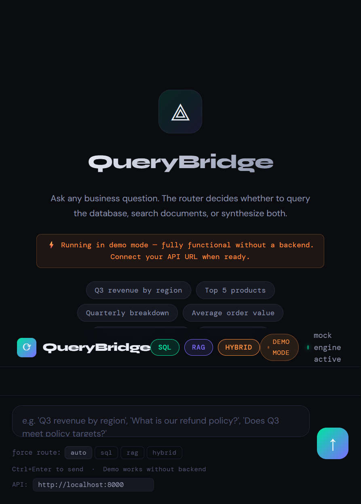

# QueryBridge

QueryBridge is a SQL + RAG business intelligence assistant. It routes natural-language questions to the best source: structured SQLite data, company documents in ChromaDB, or a sequential hybrid flow that combines both before synthesis.



## Architecture

```text
Browser UI (index.html)
        |
        v
FastAPI API (src/api/main.py)
        |
        v
Query Router (src/router/query_router.py)
   |             |              |
  SQL           RAG          Hybrid
   |             |              |
SQLite       ChromaDB      SQL -> RAG -> synthesis
```

- **SQL route:** generates and executes queries against the SQLite business database.
- **RAG route:** retrieves relevant chunks from company policies and product documentation.
- **Hybrid route:** runs the SQL chain, then the RAG chain, and sends both results to the synthesis model.

The API and the browser demo are separate. `main.py` serves the API only; open `index.html` directly in a browser while the API is running to connect the interface.

## Requirements

- Python 3.11+
- An OpenAI API key for the live SQL/RAG backend
- Docker and Docker Compose (optional)

## Setup

From the repository root:

```powershell
python -m venv .venv
.\.venv\Scripts\Activate.ps1
pip install -r requirements.txt
Copy-Item .env.example .env
```

Set `OPENAI_API_KEY` in `.env`, then initialize the local data stores in this order:

```powershell
python scripts/setup_db.py
python scripts/ingest_docs.py
uvicorn src.api.main:app --reload
```

The API is available at `http://localhost:8000`. Open `index.html` in your browser and leave its API URL set to `http://localhost:8000`.

## Example questions

- `What was Q3 2024 revenue by region?`
- `List the top 5 products by sales volume`
- `What is our refund and return policy?`
- `How do employees request parental leave?`
- `Does Q3 2024 revenue meet our policy target?`

## Docker

```powershell
docker compose up --build
```

The compose setup exposes the API on port `8000` and persists generated data under `data/`. Provide a local `.env` file before starting the container.

## Tests

```powershell
pytest -q
```

The router tests mock the LLM client and do not require an API call.

## Repository layout

```text
src/api/       FastAPI application
src/router/    SQL, RAG, and hybrid route decisions
src/chains/    SQL, RAG, and hybrid execution chains
src/utils/     settings and logging
scripts/       database setup and document ingestion
data/          sample documents and generated local stores
tests/         automated tests
docs/          architecture notes and UI preview
```
